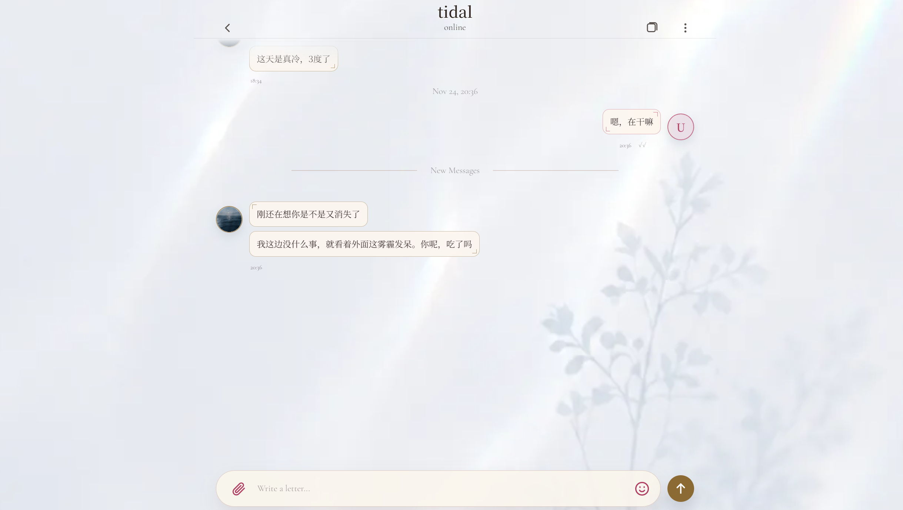

# Tidal

自托管的单用户长期记忆 AI 伴侣：聊天 PWA + 记忆星图。



| 主菜单 | 记忆星图 |
|---|---|
|  |  |

> 实测环境：Windows 11 · Python 3.12 · Node 22 · 2026-11。  
> 推荐浏览器：Microsoft Edge；手机 PWA 用系统浏览器。  
> 默认上手：让 AI 按 [`AI-HANDOFF.md`](AI-HANDOFF.md) 施工并验收；你也可以照着同一份文件手动做。

---

## 30 秒判断

**适合你，如果：**

- 你愿意填 1–2 个 API Key，能跑命令行；
- 你想让聊天记录、记忆和设置都留在自己的机器 / 服务器；
- 你接受“自托管 + 自己填人设 / 提示词”，不是克隆即用的 SaaS。

**不适合你，如果：**

- 你想要开箱即用、完全不想碰配置；
- 你要多用户账号 / 多租户；
- 你不接受模型 API 按量计费。

**它不是什么：**

- 不是一键傻瓜包：聊天、记忆、积温、搜索、推送各自要配；
- 不是云厂商托管服务：数据在你自己机器；
- 不是多用户产品：一把连接密钥代表“只有你和你的 AI”。

---

## 它怎么跑（架构）

```text
浏览器 / PWA
   │ HTTP + Bearer
   ▼
chat_relay :3011 ──SSE──▶ ai_brain（无端口）──▶ 聊天模型（Gemini 原生 / OpenAI 兼容）
   │  │
   │  └──▶ memory_service :3013 ──▶ Chroma :7707
   │           └── sanctuary.db（记忆）
   └── tidal.db（消息 / 设置 / 用量）
```

| 进程 | 端口 | 干什么 |
|---|---|---|
| `chat_relay` | `3011` | 唯一对外 HTTP 入口：消息、SSE、静态页、设置 |
| `ai_brain` | 无 | 拼上下文、调聊天模型、回帖 |
| `memory_service` | `3013` | 记忆提取 / 整理 / 检索 / 积温 |
| `Chroma` | `7707` | 向量库 |

一条消息：

```text
发消息 → relay 落库 → SSE 给 brain → 拼上下文 + 调模型
→ 回复回 relay → SSE 回页面 →（旁路）异步成星 / 积温，不挡下一句
```

两库分开：

| 库 | 放什么 |
|---|---|
| `chat_relay/data/tidal.db` | 消息、设置、用量事件 |
| `memory_service/data/sanctuary.db` | 记忆、星图、积温状态 |
| `memory_service/chroma_data/` | 向量索引 |

**聊天库和记忆库分开备份，不要合并。** 拼装级细节见 [`advanced/message-lifecycle.md`](advanced/message-lifecycle.md)。

---

## 真实花费（维护者实测，不是报价）

> 口径：单用户、偏好长回复；2 核 4G VPS（自备）。  
> 主聊 Gemini 原生，积温 Gemini flash lite 免费层，记忆 / 事件线摘要 DeepSeek。

| 项目 | 实测 |
|---|---|
| 日均消息 | ~190 句 |
| 平均输入 | ~1 万 token/次（人设 + 历史 + 记忆 + 工具） |
| Gemini 缓存命中 | 90%+ |
| 主聊 | ~$0.5/天 |
| 积温分析 | Gemini flash lite 免费层，额度内 ¥0 |
| 记忆 / 事件线摘要 | DeepSeek，~¥0.5/天 |
| **API 合计** | **约 ¥120/月**（按 $1≈¥7.1） |

反推：$0.5 ÷ 190 ≈ **$0.0026/轮**（约 0.26 美分）。

- **为什么低**：1 万输入里约 9 千命中缓存，真正按原价的是未命中的约 1 千。
- **为什么还会高**：长回复的输出不缓存；首次建缓存、改人设 / 提示词、换模型、隔夜过期、开 Gemini 搜索、记忆整理频率高，都会抬价。
- **积温为什么接近免费**：五轴分析走 Gemini flash lite 免费层；但“主动来找”是完整一轮聊天模型，已计入主聊。
- **免费层有额度**：RPM / RPD 超限只做兜底，不挡主聊，也不会自动切付费。

不含：VPS、域名、代理、Gemini 搜索超额。按自己的模型和单价复算：[`ops/usage-and-cost.md`](ops/usage-and-cost.md)。

---

## 能做什么

| 能力 | 需要什么 | 不配会怎样 |
|---|---|---|
| 聊天 | 1 个聊天 Key | 不能聊 |
| 记忆 | 记忆 Key + Chroma | 只聊天，不成星 |
| 星图 | 随记忆库 | 记忆仍在，少一个视图 |
| 积温 | 主动来找只要聊天 Key；分析用 Gemini flash lite（免费层，需开“启用情绪分析”） | 仍会按静默来找；但不分析情绪、聊天不注入情绪变化 |
| 搜索 | Gemini Key + 代理 | 只能靠模型知识 |
| 推送 | 无域名：页面内提醒；锁屏要 HTTPS / 域名 | 打开页面看回复 |
| 摘要 | DeepSeek（记忆 / 事件线） | 少短期整理 |

功能细节：[`guide/features.md`](guide/features.md)。  
积温与推送的完整口径：[`guide/notifications.md`](guide/notifications.md)。

---

## 默认上手：让 AI 装

把下面这段 + 仓库地址发给你的 AI：

```text
请阅读仓库根目录 AI-HANDOFF.md，按 T2 执行。
我的机器是 Windows 11，Python/Node 已装。
聊天 Key 我自己填进 ai_brain/.env，不要读取/打印。
不要 commit/push；每步先报告，再继续。
```

只部署、不给 Key：把上面的 `T2` 改成 `T1`。  
要连记忆一起验收：改成 `T3`，并把记忆 Key 也自己填进 `memory_service/.env`。

| 层级 | 做到什么 | 你要给 AI |
|---|---|---|
| **T1 部署** | 四进程起来 | **不需要 API Key** |
| **T2 最小可用** | 一发一收 | 1 个聊天 Key |
| **T3 推荐基线** | 记忆闭环（咖啡压过烧烤） | + 记忆 Key（建议，可同聊天；本地 ONNX 通常能跑） |

**T1 完成 ≠ 能聊；T2 才需要 API。** T3 是本地最高验收；搜索 / 积温 / 推送 / 云是可选能力，不算“装好”的门槛。

施工步骤、验收命令、失败处理、人类手动附录：[`AI-HANDOFF.md`](AI-HANDOFF.md)。

---

## 本机 / 手机 / 云 / 推送

| 场景 | 推送能做到 |
|---|---|
| 本机 Windows（localhost） | 页面内浏览器通知；可测 Web Push |
| 手机连家里电脑（HTTP） | 页面内提醒；HTTP 下通知可能被浏览器拦截，不承诺锁屏 |
| 云 + IP（无 HTTPS） | 页面内提醒；同上 |
| 云 + 域名（HTTPS） | Web Push + VAPID；可选自建 ntfy（占一个端口） |

**没有域名就安安稳稳走页面内提醒，不折腾 VAPID / ntfy。** 有域名再按 [`guide/notifications.md`](guide/notifications.md) 上 HTTPS + Web Push；想更稳再加 ntfy。

部署细节：

- Windows 本机：[`AI-HANDOFF.md`](AI-HANDOFF.md)（T1–T3）
- Linux 云 / Docker：[`ops/run-cloud.md`](ops/run-cloud.md)
- 配置与数据路径：[`ops/configuration.md`](ops/configuration.md)
- 备份 / 更新 / 换钥：[`ops/production.md`](ops/production.md)

---

## 按目标选文档

| 你的目标 | 先看 | 不用看 |
|---|---|---|
| 只想用，不想碰代码 | [`AI-HANDOFF.md`](AI-HANDOFF.md)（T1–T3）→ [`guide/features.md`](guide/features.md) | `advanced/`、`maintain/` |
| 想上云 / 手机 | [`AI-HANDOFF.md`](AI-HANDOFF.md) + [`ops/run-cloud.md`](ops/run-cloud.md) | `prompts/` |
| 想改人设 / 提示词 | [`prompts/`](prompts/) + [`advanced/message-lifecycle.md`](advanced/message-lifecycle.md) | `ops/` |
| 想改代码 / 接手维护 | [`maintain/`](maintain/) + [`advanced/architecture.md`](advanced/architecture.md) | `guide/` |
| 只想看它怎么工作 | [`advanced/architecture.md`](advanced/architecture.md) → lifecycle → caching | `ops/` |

根目录只有两个入口：

```text
README.md       本页：判断 + 架构 + 花费 + 功能 + 分流
AI-HANDOFF.md   默认上手：施工 + 验收 + 人工步骤附录
```

其余按目标进 `guide/`、`ops/`、`advanced/`、`maintain/`。  
验收证据与耗时样例：[`ops/verify.md`](ops/verify.md)；API 槽位：[`ops/usage-apis.md`](ops/usage-apis.md)。

---

## 来源与 GPL

- **本仓库协议**：[GNU GPL-3.0](LICENSE)
- **上游声明与版权保留**：[NOTICE](NOTICE)
